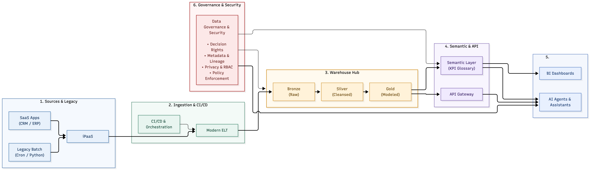

# Enterprise AI-Ready Data Platform Architecture

## 📌 Executive Summary
This repository contains the reference architecture and solution design for modernizing a legacy batch-orchestrated data environment into a governed AI-ready enterprise data hub. The design focuses on enabling secure, responsible AI agent consumption through a centralized semantic layer.

## 🏗️ Architecture Overview

The solution encompasses:
- **Modern ELT & iPaaS:** Migrating custom scripts to modern ELT pipelines, utilizing iPaaS for real-time application syncing.
- **Warehouse-Centric Hub:** A centralized data warehouse establishing standardized naming conventions and data modeling (Bronze/Silver/Gold).
- **Semantic Layer & AI Enablement:** A governed semantic layer that acts as the bridge between raw data and AI assistants/agents, enforcing policy at the query level.

## 🛡️ AI Governance & Responsible Adoption
- **Decision Rights:** Defined RACI for data ownership.
- **KPI Glossary:** Centralized metrics definitions to prevent AI hallucination.
- **Policy Enforcement:** Row-level security and metadata lineage controls (with or without a third-party catalog tool).

## 🚀 Accelerating Delivery with AI
AI tools were utilized to accelerate data profiling, schema discovery, and the generation of initial data dictionaries, reducing discovery time by 40%.

## 💻 Proof of Concept (PoC) Code
See `setup_db.py` for a localized PoC demonstrating a DuckDB warehouse-centric hub, establishing a foundation for scalable cloud deployment (Snowflake/Databricks/AWS).
